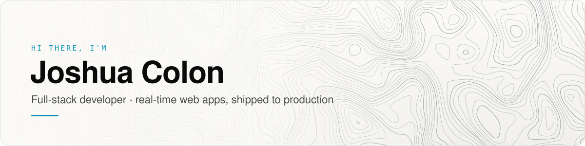
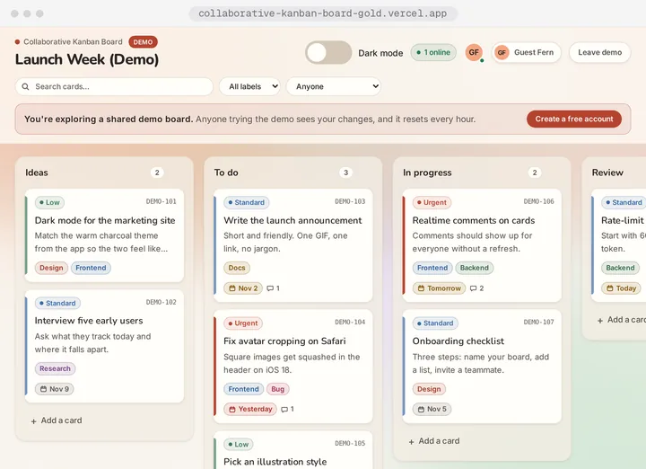
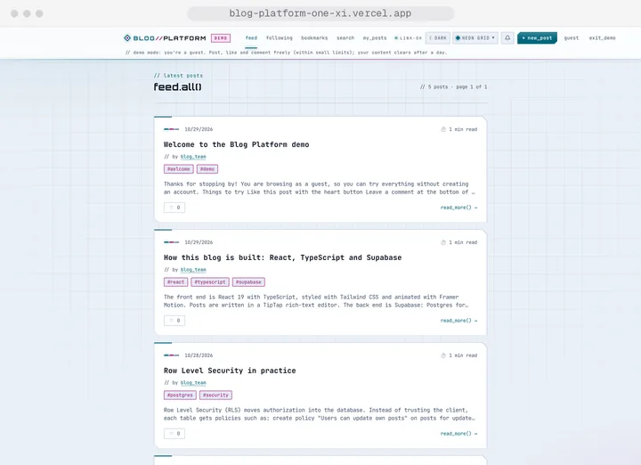
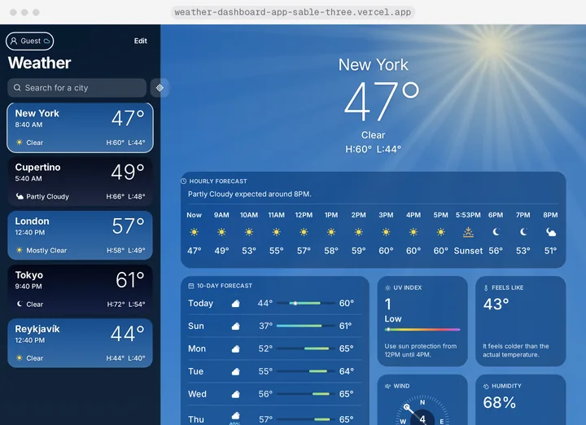
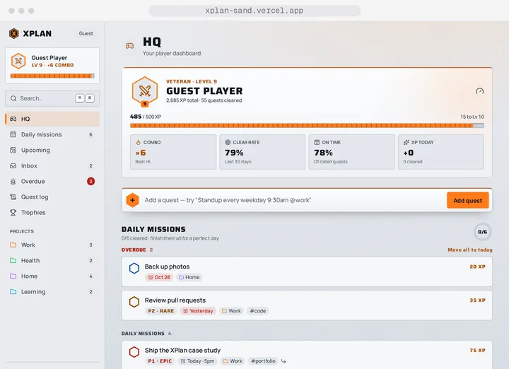
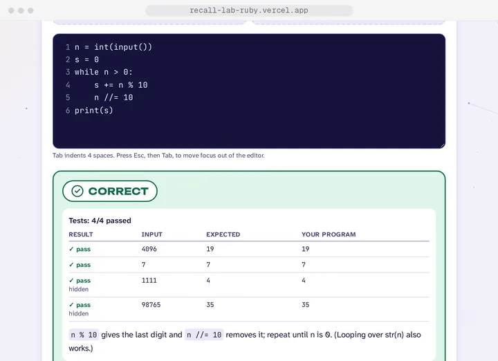
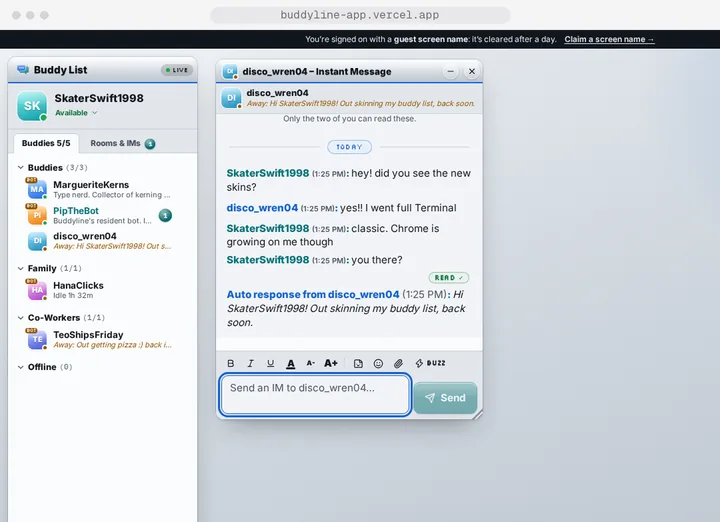

<a href="https://joshuamcolon.github.io/portfolio-project/">
<picture>
<source media="(prefers-color-scheme: dark)" srcset="assets/header-dark.svg">

</picture>
</a>

## 👋 About me

I'm a full-stack developer building real-time, production-ready web apps with **React, TypeScript, Supabase and Vercel**. I take products from an empty repo to a live deployment: a polished, responsive UI on the front, a locked-down Postgres backend behind it, and automated tests guarding every release.

What I ship:

- 🔐 **Auth and data security:** Supabase Auth, guest sessions and Postgres row-level security on every table
- ⚡ **Realtime:** live presence, instant sync across devices, chat and notifications over Supabase Realtime
- ☁️ **Serverless:** Vercel Functions and Supabase Edge Functions for APIs and AI features, plus pg_cron for scheduled jobs
- ✅ **CI and testing:** Vitest unit tests and Playwright end-to-end suites running in GitHub Actions
- ♿ **Accessibility:** keyboard-first flows, reduced-motion support and axe-checked pages

Every project below is live, and most have a **one-click demo**, so you can explore without signing up.

## 🚀 Featured projects

<table>
<tr>
<td width="50%" valign="top">
<a href="https://collaborative-kanban-board-gold.vercel.app">
<picture>
<source media="(prefers-color-scheme: dark)" srcset="assets/cards/kanban-board-dark.webp">

</picture>
</a>
<h3>Collaborative Kanban Board</h3>

Real-time team board with drag-and-drop cards, live presence and a clean, focused flow.

<code>React</code> <code>TypeScript</code> <code>Supabase Realtime</code> <code>dnd-kit</code>

<a href="https://collaborative-kanban-board-gold.vercel.app"><b>Live</b></a> · <a href="https://github.com/JoshuaMColon/collaborative-kanban-board">Code</a>

</td>
<td width="50%" valign="top">
<a href="https://blog-platform-one-xi.vercel.app">
<picture>
<source media="(prefers-color-scheme: dark)" srcset="assets/cards/blog-platform-dark.webp">

</picture>
</a>
<h3>Blog Platform</h3>

Cyber-styled blogging app with realtime comments, notifications, full-text search and AI-matched related posts.

<code>React</code> <code>TypeScript</code> <code>Supabase</code> <code>pgvector</code>

<a href="https://blog-platform-one-xi.vercel.app"><b>Live</b></a> · <a href="https://blog-platform-one-xi.vercel.app/demo">Try the demo</a> · <a href="https://github.com/JoshuaMColon/blog-platform">Code</a>

</td>
</tr>
<tr>
<td width="50%" valign="top">
<a href="https://weather-dashboard-app-sable-three.vercel.app">
<picture>
<source media="(prefers-color-scheme: dark)" srcset="assets/cards/weather-dashboard-dark.webp">

</picture>
</a>
<h3>Weather Dashboard</h3>

iPhone Weather-style app with animated skies, an hourly strip, a 10-day forecast and cities that sync across devices.

<code>React</code> <code>TypeScript</code> <code>Vercel Functions</code> <code>Open-Meteo</code>

<a href="https://weather-dashboard-app-sable-three.vercel.app"><b>Live</b></a> · <a href="https://weather-dashboard-app-sable-three.vercel.app/demo">Try the demo</a> · <a href="https://github.com/JoshuaMColon/Weather_Dashboard_App">Code</a>

</td>
<td width="50%" valign="top">
<a href="https://xplan-sand.vercel.app">
<picture>
<source media="(prefers-color-scheme: dark)" srcset="assets/cards/xplan-dark.webp">

</picture>
</a>
<h3>XPlan</h3>

A task manager that plays like an RPG: quests earn XP, levels and trophies, with natural-language quick-add and Cmd+K.

<code>React</code> <code>TypeScript</code> <code>Tailwind CSS</code> <code>Supabase</code>

<a href="https://xplan-sand.vercel.app"><b>Live</b></a> · <a href="https://xplan-sand.vercel.app/demo">Try the demo</a> · <a href="https://github.com/JoshuaMColon/task-manager">Code</a>

</td>
</tr>
<tr>
<td width="50%" valign="top">
<a href="https://recall-lab-ruby.vercel.app">
<picture>
<source media="(prefers-color-scheme: dark)" srcset="assets/cards/recall-lab-dark.webp">

</picture>
</a>
<h3>Recall Lab</h3>

Python practice platform: 304 original questions graded by real Python running in the browser via WebAssembly, with spaced repetition and a timed mock exam.

<code>React</code> <code>TypeScript</code> <code>Pyodide</code> <code>Supabase</code>

<a href="https://recall-lab-ruby.vercel.app"><b>Live</b></a> · <a href="https://recall-lab-ruby.vercel.app/demo">Try the demo</a> · <a href="https://github.com/JoshuaMColon/recall-lab">Code</a>

</td>
<td width="50%" valign="top">
<a href="https://buddyline-app.vercel.app">
<picture>
<source media="(prefers-color-scheme: dark)" srcset="assets/cards/buddyline-dark.webp">

</picture>
</a>
<h3>Buddyline</h3>

An early-2000s style instant messenger: live Buddy List, away messages, floating IM windows, Buzz and eight skins.

<code>React</code> <code>TypeScript</code> <code>Supabase Realtime</code> <code>Web Audio</code>

<a href="https://buddyline-app.vercel.app"><b>Live</b></a> · <a href="https://buddyline-app.vercel.app/demo">Try the demo</a> · <a href="https://github.com/JoshuaMColon/buddyline">Code</a>

</td>
</tr>
</table>

## 🧰 Tools I use

<a href="https://skillicons.dev">
<picture>
<source media="(prefers-color-scheme: dark)" srcset="https://skillicons.dev/icons?i=react%2Cts%2Cjs%2Chtml%2Ccss%2Ctailwind%2Cvite%2Cnodejs%2Csupabase%2Cpostgres%2Cpy%2Cvitest%2Cgit%2Cgithubactions%2Cvercel%2Cnetlify&theme=dark&perline=8">

</picture>
</a>

## 📚 Currently

Sharpening Python (WGU D335) alongside B.S. coursework at Western Governors University.

## 📈 Activity

<picture>
<source media="(prefers-color-scheme: dark)" srcset="https://streak-stats.demolab.com?user=JoshuaMColon&theme=dark&hide_border=true&background=0D1117">

</picture>

---

Thanks for stopping by! The full case studies live on my <a href="https://joshuamcolon.github.io/portfolio-project/"><b>portfolio</b></a>. ✨

